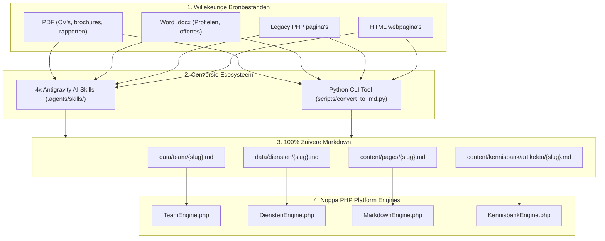

# Noppa Markdown Conversie Skills & Automatisering — Handleiding & Instructies

Dit document beschrijft de architectuur, specificaties en gebruikershandleiding voor de **Noppa Markdown Conversie Skills** en het bijbehorende automatiseringsscript [`scripts/convert_to_md.py`](file:///c:/NOPPA/OneDrive%20-%20Noppa%20Solutions%20&%20Consultants/FRESH/scripts/convert_to_md.py). 

Met dit ecosysteem converteer je willekeurige bronbestanden (**PDF curricula vitae, Word .docx documenten, legacy PHP templates en HTML webpagina's**) razendsnel naar gestandaardiseerde, 100% zuivere Markdown-bestanden die direct foutloos renderen binnen het Noppa Base Platform (`option/` en `starter-kit/`).

---

## 🧭 Inhoudsopgave

1. [Architectuur & Uitgangspunten](#-architectuur--uitgangspunten)
2. [Overzicht van de 4 Conversie Skills](#-overzicht-van-de-4-conversie-skills)
3. [Instructie 1: Teamlid Converteren (`md-converter-teamlid`)](#-instructie-1-teamlid-converteren-md-converter-teamlid)
4. [Instructie 2: Dienst / Propositie Converteren (`md-converter-dienst`)](#-instructie-2-dienst--propositie-converteren-md-converter-dienst)
5. [Instructie 3: Algemene Pagina Converteren (`md-converter-pagina`)](#-instructie-3-algemene-pagina-converteren-md-converter-pagina)
6. [Instructie 4: Kennisbank Artikel Converteren (`md-converter-kennisbank`)](#-instructie-4-kennisbank-artikel-converteren-md-converter-kennisbank)
7. [Automatisering via het Python CLI Script (`convert_to_md.py`)](#-automatisering-via-het-python-cli-script-convert_to_mdpy)
8. [Batch Conversie & Automatische Mapverwerking](#-batch-conversie--automatische-mapverwerking)
9. [Aanroepen van Skills via AI Agents (Antigravity)](#-aanroepen-van-skills-via-ai-agents-antigravity)
10. [Validatie Checklist & Kwaliteitsborging](#-validatie-checklist--kwaliteitsborging)

---

## 🏛️ Architectuur & Uitgangspunten

Het Noppa platform hanteert een strikte scheiding tussen data/content en weergavelogica:



### De 5 Gouden Regels voor Noppa Markdown:
1. **100% Zuivere Markdown**: Geen ruwe HTML-tags zoals `<div class="...">`, `<section>` of `<span style="...">` in de inhoudelijke body. Alle styling verloopt via de PHP engines.
2. **YAML Frontmatter bovenaan**: Gestructureerde metadata (titels, iconen, badges, prijzen, auteurs) staat altijd strak tussen de openings- en sluitings-`---`.
3. **Semantische Koppen**: Gebruik `##` voor hoofdsecties en `###` voor subonderdelen. `TeamEngine` en `DienstenEngine` splitsen functionaliteit op basis van deze koppen.
4. **Alleen Officiële Noppa Iconen**: Gebruik uitsluitend de 24 officiële gradient-iconen (bijv. `shield`, `sparkles`, `workflow`, `team`, `search`, `brain`, `calendar`).
5. **Noppa Typografie & Kleurcontrast**: Kentledge lettertype en WCAG 2.1 AAA contrastratio's worden automatisch gewaarborgd door de platform-engines en `custom.css`.

---

## 📦 Overzicht van de 4 Conversie Skills

| Skill Naam | Locatie | Bronbestanden | Doelpad | Toepassing |
| :--- | :--- | :--- | :--- | :--- |
| **`md-converter-teamlid`** | [`.agents/skills/md-converter-teamlid/`](file:///c:/NOPPA/OneDrive%20-%20Noppa%20Solutions%20&%20Consultants/FRESH/.agents/skills/md-converter-teamlid/SKILL.md) | PDF CV's, Word .docx profielen, LinkedIn exports, HTML teamleden | `data/team/{slug}.md` | Consultantprofielen met biografie, quick facts, vCard en automatische profile-cards. |
| **`md-converter-dienst`** | [`.agents/skills/md-converter-dienst/`](file:///c:/NOPPA/OneDrive%20-%20Noppa%20Solutions%20&%20Consultants/FRESH/.agents/skills/md-converter-dienst/SKILL.md) | PDF brochures, offertes, Word dienstbladen, PHP dienstenpagina's | `data/diensten/{slug}.md` | Dienstenpagina's met hero, pillars, use cases, stappenplan, pricing grid en FAQ. |
| **`md-converter-pagina`** | [`.agents/skills/md-converter-pagina/`](file:///c:/NOPPA/OneDrive%20-%20Noppa%20Solutions%20&%20Consultants/FRESH/.agents/skills/md-converter-pagina/SKILL.md) | PDF rapporten, Word documenten, visies, HTML landingspagina's | `content/pages/{slug}.md` | Algemene pagina's met modulaire sectietypes (cards, stats, visual, pinned-scroll, cta). |
| **`md-converter-kennisbank`** | [`.agents/skills/md-converter-kennisbank/`](file:///c:/NOPPA/OneDrive%20-%20Noppa%20Solutions%20&%20Consultants/FRESH/.agents/skills/md-converter-kennisbank/SKILL.md) | PDF whitepapers, Word artikelen, blogs, documentatie | `content/kennisbank/artikelen/{slug}.md` | Kennisbankartikelen met leestijd, categorie, auteur-koppeling en sticky Table of Contents. |

---

## 👤 Instructie 1: Teamlid Converteren (`md-converter-teamlid`)

### 1.1 Doel & URL
- **Bestand**: `data/team/{slug}.md` (bijv. `data/team/jan-jansen.md`)
- **URL**: Bereikbaar via `/team/jan-jansen` of `index.php?page=team&id=jan-jansen`
- **Foto**: `./assets/images/Jan Jansen.jpg` (vierkant 600×600 px)

### 1.2 Het YAML Frontmatter Schema
```yaml
---
firstName: Jan
lastName: Jansen
pageTitle: Jan Jansen | M365 Architect | Noppa Solutions & Consultants
pageDesc: Jan Jansen — Senior Microsoft 365 Architect en SharePoint Specialist bij Noppa.
roleTitle: Senior M365 Architect & Cloud Specialist
shortBio: Jan helpt organisaties bij het ontwerpen van schaalbare, veilige cloudinfrastructuren. Met ruim 12 jaar ervaring vertaalt hij complexe IT-vraagstukken naar pragmatische werkplekken.
jobTitle: Senior Consultant
phone: "+31 6 12 34 56 78"
email: "jan@noppa.nl"
linkedin: "linkedin.com/in/janjansen"
location: "'s-Hertogenbosch, Noord-Brabant"
image: "./assets/images/Jan Jansen.jpg"

# Quick facts voor de zijbalk (compacte badges)
qf_experience: "12+ jaar M365"
qf_specialism: "SharePoint & Architectuur"
qf_region: "Nederland & België"
qf_languages: "NL · EN · DU"
---
```

### 1.3 De Markdown Body Structuur
Onder de frontmatter volgt de inhoud in pure Markdown met strikte `## ` koppen:

```markdown
## Over Jan
Met ruim 12 jaar ervaring binnen het Microsoft-ecosysteem heeft Jan tientallen complexe migraties en intranetprojecten geleid. Zijn kracht ligt in het vertalen van ingewikkelde governance- en architectuurvraagstukken naar een overzichtelijke en veilige werkomgeving.

## Expertise
### SharePoint Online Architectuur
Ontwerp van schaalbare sites, hub-structuren en documentbibliotheken met doordachte metadata.

### Rechten & Governance
Inrichten van veilige toegangsmodellen zonder wildgroei aan losse groepen of verweesde rechten.

### Cloud Migraties
Soepele overstap van on-premises bestandsservers naar SharePoint Online en OneDrive for Business.

## Werkervaring
### 2024 — heden | Senior M365 Architect | Noppa Solutions & Consultants
Verantwoordelijk voor de architectuur en technische regie bij grootschalige SharePoint- en Copilot-projecten.

### 2018 — 2024 | Cloud Consultant | Zakelijke Dienstverlening
Leiding gegeven aan migratieteams en implementatie van moderne Microsoft 365-werkplekken bij MKB+.

## Referenties
### "Jan brengt direct rust en overzicht"
Jan doorziet binnen een uur waar de knelpunten in de bestandsstructuur zitten en levert een plan waar iedereen direct mee verder kan.
*— IT Manager, Logistieke Dienstverlener*

## Certificeringen (optioneel)
- Microsoft 365 Certified: Enterprise Administrator Expert
- Information Protection and Compliance Administrator Associate
```

---

## 💼 Instructie 2: Dienst / Propositie Converteren (`md-converter-dienst`)

### 2.1 Doel & URL
- **Bestand**: `data/diensten/{slug}.md` (bijv. `data/diensten/beveiliging-compliance.md`)
- **URL**: Bereikbaar via `/diensten/beveiliging-compliance`
- **Menu-koppeling**: Automatisch of via `content/pages/diensten.md`

### 2.2 Het YAML Frontmatter Schema
```yaml
---
id: "beveiliging-compliance"
order: 7
title: "M365 Beveiliging & Compliance | Noppa Solutions & Consultants"
shortTitle: "Beveiliging & Compliance"
eyebrow: "Veilig en in controle"
badge: "Microsoft Purview & Security"
badge_icon: "shield" # Kies uit de 24 Noppa iconen
hero_title: "Houd controle over uw data in het <span class='gradient-text'>AI-tijdperk</span>"
hero_subtitle: "Voorkom datalekken, borg gevoelige bedrijfsinformatie en voldoe moeiteloos aan wet- en regelgeving met Microsoft Purview en beproefde governance-kaders."
hero_cta_primary:
  text: "Vraag een Security Scan aan"
  url: "/contact"
  icon: "shield"
hero_cta_secondary:
  text: "Bekijk onze pakketten →"
  url: "#pricing"

# Cijferbalk in intro
stats:
  - num: "100%"
    lbl: "AVG-compliant"
  - num: "0"
    lbl: "Oversharing risico"
  - num: "24/7"
    lbl: "Inzicht in datastromen"
  - num: "A–Z"
    lbl: "Purview implementatie"

# Call-to-Action banner onderaan de pagina
cta:
  title: "Klaar om uw data waterdicht te beveiligen?"
  desc: "Plan een vrijblijvend adviesgesprek van 30 minuten met een van onze compliance-specialisten."
  btn_text: "Plan een adviesgesprek →"
  btn_url: "/contact"

# Optioneel: Transparant Pricing Grid
pricing:
  title: "Vaste tarieven, maximale zekerheid"
  subtitle: "Transparante Pakketten"
  desc: "Kies de beveiligingsscope die past bij het risicoprofiel van uw organisatie. Alle bedragen zijn exclusief BTW."
  plans:
    - tier: "Basis"
      name: "Security Scan"
      target: "Voor organisaties die inzicht willen in hun huidige risico's."
      featured: false
      price_prefix: "Eenmalig"
      price_amount: "€ 1.850"
      price_suffix: "excl. BTW · binnen 1 week rapport"
      cta:
        text: "Vraag scan aan"
        url: "/contact"
      features:
        - "Scan van tenant en rechtenstructuur"
        - "Controle op oversharing in SharePoint"
        - "Rapport met prioriteiten en quick wins"
    - tier: "Compleet"
      name: "Purview Inrichting"
      target: "Volledige implementatie van sensitivity labels en DLP."
      featured: true
      badge: "Meest gekozen"
      price_prefix: "Vanaf"
      price_amount: "€ 4.650"
      price_suffix: "excl. BTW · doorlooptijd 3 tot 5 weken"
      cta:
        text: "Start implementatie"
        url: "/contact"
      features:
        - "Alles uit de Security Scan"
        - "Inrichten Microsoft Purview & DLP policies"
        - "Informatieclassificatie en labels"
        - "Instructieworkshop voor beheerders"
---
```

### 2.3 De Markdown Body Structuur
`DienstenEngine.php` herkent de volgende H2 koppen en compileert deze naar interactieve componenten:
- `## De uitdaging`: Introductieparagrafen over het probleem.
- `## Onze aanpak`: 3 of 4 pijlers met H3 koppen.
- `## Praktijkvoorbeelden`: Concrete klantencases.
- `## Stappenplan`: Genummerde fasen van de implementatie.
- `## Veelgestelde vragen`: Accordion FAQ met antwoorden.

### 2.4 Flexibele Pricing & Plans Positionering
De redacteur kan het in YAML gedefinieerde tarievenoverzicht (`pricing`) flexibel op elke gewenste plek in de Markdown-body positioneren:
- **Directe plaatsing**: `<!-- section: pricing -->` of `<!-- pricing -->`. Schakelt automatische plaatsing na de intro of aan het einde uit.
- **Met achtergrond & titels**: `<!-- section: tarieven type="pricing" bg="tint" title="..." subtitle="..." desc="..." -->`.
  *Beschikbare achtergronden (`bg`)*: `surface` (wit), `tint` (lichtblauw), `navy` (diepblauw), `ink` (donker), `hero` (hero-gradient), `royal` (royalblauw), `gradient` (signature gradient), `alt` (standaard zachtgrijs).
- **Plannen filteren**: `plans="Basic,Advanced"` of `plan="Maatwerk"` om pakketten te splitsen over verschillende pagina-onderdelen.
- **Inline plan embeds**: `<!-- plan: Basic -->` of `[plan: "Basic"]` binnen een lopende tekstparagraaf (rendert een gecentreerde `.pcard`).
- **Kop-gebaseerd**: `## Onze Tarieven & Pakketten` (herkent automatisch de koppen *Tarieven*, *Prijzen*, *Pakketten*, *Pricing*, *Investering*).


---

## 📄 Instructie 3: Algemene Pagina Converteren (`md-converter-pagina`)

### 3.1 Doel & URL
- **Bestand**: `content/pages/{slug}.md` (bijv. `content/pages/visie.md`, `copilot-realiteitscheck.md`)
- **URL**: Bereikbaar via `/{slug}` of `index.php?page={slug}`

### 3.2 Het YAML Frontmatter Schema
```yaml
---
title: "Onze Visie op Productiviteit | Noppa Solutions & Consultants"
description: "Lees hoe Noppa kijkt naar de toekomst van werk, de rol van AI en de onmisbare menskant van technologie."
canonical: "https://noppa.nl/visie"

# Optionele verticale scroll-instellingen
scroll_mode: "snap"        # 'snap' voor 100vh viewport snapping op desktop
scroll_nav: true           # Toont zwevende interactieve side-dots aan de rechterkant

hero:
  badge: "Visie & Filosofie"
  badge_icon: "idea"
  title: "Technologie moet voor mensen werken, <span class='gradient-text'>niet andersom</span>"
  subtitle: "Wij geloven dat de echte productiviteitswinst van AI en cloud niet in de licentie zit, maar in de gewoontes van de mensen die er dagelijks mee werken."
  bg_image: "./assets/images/header-bg.jpg" # Optionele header achtergrondafbeelding
  bg_overlay: "dark"                       # 'dark', 'gradient' of 'glass'
  cta_primary:
    text: "Lees onze aanpak"
    url: "/diensten"
  cta_secondary:
    text: "Maak kennis met ons team"
    url: "/over-ons"
---
```

### 3.3 De Sectiemarkers (`<!-- section: ... -->`)
Pagina's worden flexibel opgebouwd met sectietags:
```markdown
<!-- section: kernfilosofie type="content" title="De Menskant van Werk" subtitle="Onze Overtuiging" -->
## Software is een middel, geen doel
Veel organisaties investeren duizenden euro's in de nieuwste Microsoft-licenties...

<!-- section: diensten-grid type="cards" cols="3" title="Waarmee Wij Helpen" subtitle="Onze Expertise" -->
## Microsoft Copilot Adoptie
*Icoon: sparkles*
Haal maximaal rendement uit Microsoft Copilot met praktische workflows en prompts.
[Bekijk Copilot Dienst](/diensten/ai-copilot)

## SharePoint & Intranetten
*Icoon: dashboard*
Overzichtelijke en veilige werkplekken waar medewerkers informatie binnen enkele seconden vinden.
[Bekijk SharePoint](/diensten/processen-portalen)

<!-- section: impact type="stats" title="Onze Impact in Cijfers" subtitle="Bewezen Resultaten" -->
- **4 uur** Gemiddelde wekelijkse tijdsbesparing per medewerker
- **85%** Actieve adoptiegraad na onze verandertrajecten
- **100%** Borging binnen uw eigen Microsoft 365-tenant

<!-- section: actie type="cta" -->
## Wil je ontdekken wat dit voor jouw team betekent?
Plan een vrijblijvende inspiratiesessie van 30 minuten met een van onze adviseurs.
[Plan een gesprek in](/contact)
```

---

## 📚 Instructie 4: Kennisbank Artikel Converteren (`md-converter-kennisbank`)

### 4.1 Doel & URL
- **Bestand**: `content/kennisbank/artikelen/{slug}.md`
- **URL**: Bereikbaar via `/kennisbank/{slug}`
- **Overzicht**: Verschijnt automatisch in de kennisbankcatalogus met categorie-filtering, auteur-koppeling en zoeksysteem.

### 4.2 Het YAML Frontmatter Schema
```yaml
---
title: "De Ultieme Gids voor Effectieve Microsoft Copilot Prompts"
beschrijving: "Leer hoe u krachtige prompts formuleert in Word, Teams en Outlook om direct tijd te besparen met Copilot."
datum: 2026-10-16
categorie: "Microsoft Copilot" # Bijv: Microsoft Copilot, SharePoint & M365, Adoptie & Cultuur, Beveiliging & Governance
auteur: "Rik Dobbelsteen"     # Koppelt aan een teamlid uit data/team/
leestijd: "5 min"
featured: false               # true om artikel bovenaan uit te lichten
pdf: "copilot-prompt-gids.pdf" # Optionele link naar downloadbare PDF
tags:
  - Microsoft Copilot
  - AI Prompts
  - Productiviteit
---
```

### 4.3 Markdown Body & Sticky Table of Contents
De `KennisbankEngine.php` leest alle `## ` koppen en genereert automatisch een **zwevende Table of Contents** met actieve scroll-tracking:

```markdown
# De Ultieme Gids voor Effectieve Microsoft Copilot Prompts

> **Samenvatting:** Een goede prompt bevat vier elementen: doel, context, bron en gewenste toon. In dit artikel behandelen we praktijkvoorbeelden voor direct gebruik binnen Word, Teams en Outlook.

---

## Waarom de meeste prompts teleurstellen
Wanneer u Copilot vraagt: *"Schrijf een offerte voor klant X"*, krijgt u een generiek antwoord...

### De 4 bouwstenen van een goede prompt
1. **Doel**: Wat moet Copilot precies produceren?
2. **Context**: Voor wie is het bedoeld en wat is de achtergrond?
3. **Bron**: Welke bestanden of e-mails moet Copilot als bronmateriaal gebruiken?
4. **Verwachting**: Wat is de lengte, stijl en vorm van de output?

---

## Praktijkvoorbeelden per applicatie
Hieronder vindt u beproefde prompts die direct resultaat opleveren.
```

---

## 🛠️ Automatisering via het Python CLI Script (`convert_to_md.py`)

Het meegeleverde script [`scripts/convert_to_md.py`](file:///c:/NOPPA/OneDrive%20-%20Noppa%20Solutions%20&%20Consultants/FRESH/scripts/convert_to_md.py) verzorgt de automatische extractie en opmaakconversie vanuit de commandoregel.

### 1. Vereisten & Installatie
Zorg voor Python 3.10 of hoger. Installeer optioneel de extractie-bibliotheken:
```bash
pip install python-docx pypdf beautifulsoup4
```
*(Als de bibliotheken ontbreken, valt het script automatisch terug op een ingebouwde pure-python tekstextractie).*

### 2. Commandolijn Argumenten
```bash
python scripts/convert_to_md.py --input <BRONBESTAND> --type <TYPE> [OPTIES]
```

| Vlag | Omschrijving | Verplicht | Voorbeeld |
| :--- | :--- | :--- | :--- |
| `--input`, `-i` | Pad naar het bronbestand (`.pdf`, `.docx`, `.php`, `.html`, `.txt`) | **Ja** | `--input "dossier/cv.pdf"` |
| `--type`, `-t` | Conversiedoel: `teamlid`, `dienst`, `pagina`, of `kennisbank` | **Ja** | `--type teamlid` |
| `--slug`, `-s` | URL-slug voor het doelbestand (bepaalt de bestandsnaam) | Nee (auto) | `--slug jan-jansen` |
| `--title` | Expliciete titel voor frontmatter | Nee (auto) | `--title "Jan Jansen"` |
| `--output`, `-o` | Aangepast doelpad (overschrijft standaard doellocatie) | Nee | `--output "custom/pad.md"` |
| `--category` | Categorie voor kennisbank artikelen | Nee | `--category "Microsoft Copilot"` |
| `--author` | Auteur voor kennisbank artikelen | Nee | `--author "Rik Dobbelsteen"` |

### 3. Praktijkvoorbeelden per Conversietype

#### Voorbeeld 1: Teamlid Converteren (CV naar `data/team/`)
```bash
python scripts/convert_to_md.py \
  --input "C:\Documenten\CV-Kees-Koertshuis.pdf" \
  --type teamlid \
  --slug kees-koertshuis \
  --title "Kees Koertshuis"
```
*Resultaat*: Genereert `data/team/kees-koertshuis.md` met alle Quick Facts, Over Kees, Expertise en Werkervaring.

#### Voorbeeld 2: Dienst / Propositie Converteren (Brochure naar `data/diensten/`)
```bash
python scripts/convert_to_md.py \
  --input "C:\Offertes\Propositie-AI-Security.docx" \
  --type dienst \
  --slug ai-security \
  --title "Microsoft AI Security & Compliance"
```
*Resultaat*: Genereert `data/diensten/ai-security.md` inclusief hero frontmatter, stats, pillars en tarieven.

#### Voorbeeld 3: Algemene Pagina Converteren (Legacy PHP/HTML naar `content/pages/`)
```bash
python scripts/convert_to_md.py \
  --input "C:\OudeWebsite\over-ons.php" \
  --type pagina \
  --slug over-ons \
  --title "Over Noppa Solutions & Consultants"
```
*Resultaat*: Genereert `content/pages/over-ons.md` met `<!-- section: ... -->` indeling.

#### Voorbeeld 4: Kennisbank Artikel Converteren (Whitepaper naar `content/kennisbank/artikelen/`)
```bash
python scripts/convert_to_md.py \
  --input "C:\Whitepapers\Copilot-Adoptie-Gids.pdf" \
  --type kennisbank \
  --slug copilot-adoptie-gids \
  --title "Copilot Adoptie Strategie voor het MKB" \
  --category "Adoptie & Cultuur" \
  --author "Deborah Stahlecker"
```
*Resultaat*: Genereert `content/kennisbank/artikelen/copilot-adoptie-gids.md` met automatische Table of Contents.

---

## ⚡ Batch Conversie & Automatische Mapverwerking

Wil je een hele map vol documenten tegelijk converteren? Gebruik dan een eenvoudig PowerShell- of Bash-script om over alle bestanden in een invoermap te itereren:

### PowerShell Batch Script:
```powershell
# Converteer alle PDF's in een map naar Teamlid Markdown:
Get-ChildItem -Path "C:\Import\CVs\*.pdf" | ForEach-Object {
    $slug = $_.BaseName.ToLower() -replace '[^a-z0-9]+', '-'
    python scripts/convert_to_md.py --input $_.FullName --type teamlid --slug $slug --title $_.BaseName
}

# Converteer alle Word documenten naar Kennisbank artikelen:
Get-ChildItem -Path "C:\Import\Artikelen\*.docx" | ForEach-Object {
    $slug = $_.BaseName.ToLower() -replace '[^a-z0-9]+', '-'
    python scripts/convert_to_md.py --input $_.FullName --type kennisbank --slug $slug --title $_.BaseName --category "Algemeen"
}
```

---

## 🤖 Aanroepen van Skills via AI Agents (Antigravity)

Als je in de Antigravity IDE of chat pair-programmeert met een agent, kun je de skills direct activeren:

1. **Rechtstreeks via de chat**:
   > *"Gebruik de skill `md-converter-teamlid` om het bestand C:\Downloads\CV-Pieter.pdf om te zetten naar een Noppa teamlid Markdown bestand."*

2. **Voor proposities en offertes**:
   > *"Converteer de offerte in C:\Offertes\Dienst-Copilot.docx met `md-converter-dienst`. Zorg dat de pricing tiers uit het document netjes in het YAML pricing block komen."*

3. **Voor whitepapers**:
   > *"Zet het bijgevoegde whitepaper om naar een kennisbank artikel met `md-converter-kennisbank`. Categorie: 'Beveiliging & Governance', auteur: 'Rik Dobbelsteen'."*

De agent leest de instructies uit `SKILL.md`, voert de tekstextractie uit, vult ontbrekende metadata pragmatisch aan volgens de Noppa standaarden en slaat het doelbestand direct op de juiste plaats op!

---

## ✅ Validatie Checklist & Kwaliteitsborging

Controleer elk geconverteerd Markdown-bestand aan de hand van deze checklist vóór publicatie:

- [ ] **Geen ruwe HTML tags**: Geen `<div>`, `<section>`, `<article>`, `<p>` of `<br>` in de tekst.
- [ ] **YAML frontmatter syntaxis**:
  - Begint op regel 1 met `---` en sluit af met `---`.
  - Inspringing is exact 2 spaties (geen tabs!).
  - Teksten met speciale tekens (zoals `:` of `'`) staan tussen dubbele aanhalingstekens (`"..."`).
- [ ] **Iconen**: Alle gekozen iconen bestaan in `assets/icons/` (bijv. `shield`, `sparkles`, `workflow`, `brain`, `team`, `search`).
- [ ] **Afbeeldingen**: Paden naar profielfoto's of banners beginnen met `./assets/images/...` en de bestanden staan fysiek in die map.
- [ ] **Koppenstructuur**:
  - Slechts één H1 (`#`) per document (vaak in de frontmatter `title:` of `hero_title:`).
  - Hoofdsecties beginnen met `## `.
  - Subsecties beginnen met `### `.
- [ ] **Links**: Interne links gebruiken relatieve paden (bijv. `/contact` of `/diensten/ai-copilot`), géén hardcoded domeinnamen (`https://noppa.nl/...`).

---

© 2026 Noppa Solutions & Consultants — Ecosysteem & Documentatie Conversie Skills.
