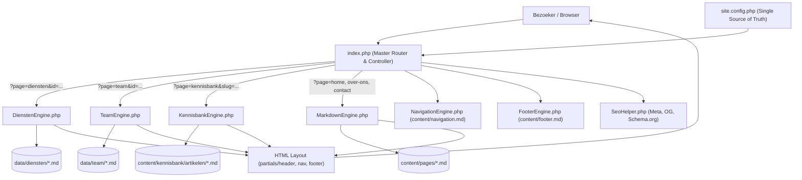

# Noppa Solutions & Consultants — Platform Documentatie & Gebruikersinstructie

Welkom bij de officiële documentatie van het **Noppa Solutions & Consultants Base Platform**. 
Dit platform is gebouwd op een moderne architectuur waarin **PHP als slimme component-compiler** fungeert en alle inhoud wordt beheerd in **100% zuivere Markdown (`.md`)**. 

Geen complexe databases, geen trage CMS-plugins en **geen honderden regels onoverzichtelijke HTML-code**: alles is modulair, snel, SEO-geoptimaliseerd en direct versiebeheerd via Git.

---

## 📑 Inhoudsopgave

1. [Architectuur & Kernfilosofie](#-architectuur--kernfilosofie)
2. [Mappenstructuur van het Platform](#-mappenstructuur-van-het-platform)
3. [URL Routing & Navigatiemodel](#-url-routing--navigatiemodel)
4. [Handleiding: Nieuwe Dienst Aanmaken](#-handleiding-nieuwe-dienst-aanmaken)
5. [Handleiding: Nieuw Teamlid Aanmaken](#-handleiding-nieuw-teamlid-aanmaken)
6. [Handleiding: Nieuwe Pagina Aanmaken](#-handleiding-nieuwe-pagina-aanmaken)
7. [Handleiding: Nieuw Kennisbank Artikel Aanmaken](#-handleiding-nieuw-kennisbank-artikel-aanmaken)
8. [Handleiding: Juridische Pagina's (Algemene Voorwaarden & Privacy)](#-handleiding-juridische-paginas-algemene-voorwaarden--privacy)
9. [Officiële Noppa Vector Iconen (24 Iconen)](#-officiële-noppa-vector-iconen-24-iconen)
10. [Noppa Design System & Richtlijnen (UX/UI)](#-noppa-design-system--richtlijnen-uxui)
11. [SEO, Sitemap & Server Configuratie](#-seo-sitemap--server-configuratie)
12. [White-Label & Hergebruik voor Andere Projecten](#-white-label--hergebruik-voor-andere-projecten)
13. [Troubleshooting & Veelvoorkomende Valkuilen](#-troubleshooting--veelvoorkomende-valkuilen)
14. [Conversie Skills & Automatisering (PDF, Word, PHP, HTML naar MD)](#-conversie-skills--automatisering-pdf-word-php-html-naar-md)

---

## 🏛️ Architectuur & Kernfilosofie

Het platform combineert de flexibiliteit van statische Markdown-bestanden met de kracht van modulaire PHP-engines:



### De Gouden Regel: 100% Zuivere Markdown
Inhoudsbestanden (`.md`) bevatten **geen ruwe HTML-tags** (`<div>`, `<section>`, `<table>`, `<details>`). De PHP-engines analyseren de structuur van de Markdown (koppen, opsommingen, tabellen en YAML frontmatter) en compileren deze automatisch naar toegankelijke Noppa BEM-componenten volgens WCAG 2.1 AAA richtlijnen.

> [!IMPORTANT]
> **Gebruik nooit 4 spaties of tabs om tekst in te springen in Markdown**, tenzij je expliciet een `<pre><code>` programmeer-codeblok wilt tonen. Inspringing van 4 spaties zorgt er volgens de Markdown-standaard voor dat tekst als letterlijke code wordt afgedrukt!

---

## 📁 Mappenstructuur van het Platform

```text
option/
├── site.config.php                # Centrale configuratie & white-label instellingen (Single Source of Truth)
├── index.php                      # Centrale router & controller
├── .htaccess                      # Apache rewrite rules voor schone URLs
├── robots.txt                     # Instructies voor Google/Bing & sitemap link
├── sitemap.php                    # Dynamische XML sitemap generator
├── sitemap.xml                    # Statische XML sitemap fallback
│
├── includes/                      # De PHP Core Engines (100% white-label & configureerbaar)
│   ├── Parsedown.php              # Snelle, betrouwbare GitHub Flavored Markdown parser
│   ├── DienstenEngine.php         # Slimme component-compiler voor diensten & pricing
│   ├── TeamEngine.php             # Consultant profiel-compiler met quick facts & vCard
│   ├── KennisbankEngine.php       # Kennisbank catalogus, categorieën & auto TOC
│   ├── LegalEngine.php            # Juridische document compiler met sticky TOC & scrollspy
│   ├── MarkdownEngine.php         # Algemene pagina- en sectieparser
│   ├── NavigationEngine.php       # Header- en mobile menu generator
│   ├── FooterEngine.php           # Footer kolommen generator
│   └── SeoHelper.php              # Geautomatiseerde SEO, Open Graph & JSON-LD schema
│
├── partials/                      # Herbruikbare Template Componenten
│   ├── header.php                 # HTML <head>, SEO tags, FOUC-prevention, fonts
│   ├── nav.php                    # Sticky glassmorphism header & drawer navigatie
│   ├── hero.php                   # Algemene hero partial voor contentpagina's
│   ├── footer.php                 # Footer grid, copyright & scripts
│   └── cookie-banner.php          # AVG/GDPR cookie banner & consent modal
│
├── data/                          # Gestructureerde Data in Markdown
│   ├── diensten/                  # Alle diensten (.md bestanden)
│   │   ├── adoptie-begeleiding.md
│   │   ├── ai-copilot.md
│   │   ├── copilot-ai-experience.md
│   │   ├── copilot-plannen.md
│   │   ├── processen-portalen.md
│   │   └── workshops-trainingen.md
│   ├── team/                      # Alle consultant profielen (.md bestanden)
│   │   ├── rik-dobbelsteen.md
│   │   ├── deborah-stahlecker.md
│   │   ├── kees-koertshuis.md
│   │   ├── daniel-giessenburg.md
│   │   └── willem-blanken.md
│   └── legal/                     # Juridische documenten (.md bestanden)
│       ├── algemene-voorwaarden.md
│       └── privacy-policy.md
│
├── content/                       # Content & Kennisbank in Markdown
│   ├── navigation.md              # Header navigatiestructuur & CTA
│   ├── footer.md                  # Footer kolommen, contactinfo & links
│   ├── pages/                     # Algemene pagina's (home, over-ons, contact, diensten)
│   │   ├── home.md
│   │   ├── diensten.md
│   │   ├── over-ons.md
│   │   ├── contact.md
│   │   ├── kennisbank.md
│   │   └── 404.md
│   └── kennisbank/
│       └── artikelen/             # Kennisbank artikelen (.md)
│           ├── checklist-admin-center-configuratie.md
│           ├── copilot-adoptie-strategie.md
│           └── ...
│
├── diensten/                      # Standalone PHP delegates voor directe links
│   ├── index.php                  # Overzicht delegate
│   ├── ai-copilot.php             # Delegate voor /diensten/ai-copilot
│   ├── processen-portalen.php     # Delegate voor /diensten/processen-portalen
│   └── ...
│
├── team/                          # Standalone PHP delegates voor teamleden
│   ├── index.php                  # Overzicht delegate
│   ├── rik-dobbelsteen.php        # Delegate voor /team/rik-dobbelsteen
│   └── ...
│
└── assets/                        # Statische Web Assets
    ├── css/
    │   ├── noppa.css              # Noppa Base Design Tokens & Grid
    │   └── custom.css             # Componenten (pcards, timeline, pillars, cta-final, etc.)
    ├── fonts/
    │   └── Kentledge-Regular.woff # Officiële Noppa typografie (Kentledge)
    ├── icons/                     # De 24 officiële Noppa SVG gradient iconen
    ├── images/                    # Afbeeldingen, teamfoto's en banners
    ├── js/
    │   └── site.js                # Theme switcher (Dark/Light/Auto), drawer, cookies
    └── logos/                     # Officiële Noppa logo's (Light & Dark variant)
```

---

## 🔗 URL Routing & Navigatiemodel

Het platform ondersteunt twee URL-structuren tegelijkertijd zonder dat er code aangepast hoeft te worden:

1. **Clean URLs (Aanbevolen op productie via `.htaccess`):**
   - Homepage: `/`
   - Algemene pagina: `/over-ons`, `/contact`, `/diensten`
   - Specifieke dienst: `/diensten/ai-copilot`, `/diensten/processen-portalen`
   - Consultant profiel: `/team/rik-dobbelsteen`, `/team/deborah-stahlecker`
   - Kennisbank artikel: `/kennisbank/copilot-adoptie-strategie`
   - Kennisbank categorie filter: `/kennisbank?cat=Microsoft+Copilot`

2. **Query Parameter URLs (Werkt altijd direct in lokale dev-omgevingen):**
   - Algemene pagina: `index.php?page=over-ons`
   - Specifieke dienst: `index.php?page=diensten&id=ai-copilot`
   - Consultant profiel: `index.php?page=team&id=rik-dobbelsteen`
   - Kennisbank artikel: `index.php?page=kennisbank&slug=copilot-adoptie-strategie`

> [!TIP]
> **Interne links schrijven in Markdown:**  
> Schrijf interne links altijd als absolute paden vanaf de root, bijvoorbeeld `[Bekijk onze aanpak](/diensten/ai-copilot)` of `[Neem contact op](/contact)`. De router (`formatUrl()`) herkent dit automatisch en vertaalt de URL naar het juiste formaat, ongeacht of de website in een submap of root draait.

---

## 🛠️ Handleiding: Nieuwe Dienst Aanmaken

Elke dienst wordt gedefinieerd in een Markdown-bestand in de map `data/diensten/`. De `DienstenEngine.php` leest dit bestand en compileert het automatisch naar een gestructureerde dienstpagina met hero, pillars, use cases, stappenplan, governance-checklists, pricing grid en FAQ.

### Stap 1: Bestand aanmaken
Maak een bestand aan in `data/diensten/{slug}.md`, bijvoorbeeld:
`data/diensten/beveiliging-compliance.md`

### Stap 2: YAML Frontmatter configureren
De frontmatter bovenaan het bestand bevat alle metadata, pricing en de CTA:

```yaml
---
id: "beveiliging-compliance"
order: 7
title: "M365 Beveiliging & Compliance | Noppa Solutions & Consultants"
shortTitle: "Beveiliging & Compliance"
eyebrow: "Veilig en in controle"
badge: "Microsoft Purview & Security"
badge_icon: "shield"
hero_title: "Houd controle over uw data in het <span class='gradient-text'>AI-tijdperk</span>"
hero_subtitle: "Voorkom datalekken, borg gevoelige bedrijfsinformatie en voldoe moeiteloos aan wet- en regelgeving met Microsoft Purview en beproefde governance-kaders."
hero_cta_primary:
  text: "Vraag een Security Scan aan"
  url: "/contact"
  icon: "shield"
hero_cta_secondary:
  text: "Bekijk onze pakketten →"
  url: "#pricing"

# Optie A: Stats blok (voor rechterkolom van de Intro)
stats:
  - num: "100%"
    lbl: "AVG-compliant"
  - num: "0"
    lbl: "Oversharing risico"
  - num: "24/7"
    lbl: "Inzicht in datastromen"
  - num: "A–Z"
    lbl: "Purview implementatie"

# Optie B: Of gebruik intro_pillars (3 voordelen in de rechterkolom)
# intro_pillars:
#   - icon: "shield"
#     title: "Grip op data"
#     desc: "Precies weten wie waar toegang toe heeft."

# Call-to-Action banner onderaan de pagina
cta:
  title: "Klaar om uw datawaterdicht te beveiligen?"
  desc: "Plan een vrijblijvend adviesgesprek van 30 minuten met een van onze compliance-specialisten."
  btn_text: "Plan een adviesgesprek →"
  btn_url: "/contact"

# Optioneel: Meerkoloms Pricing Grid (Basis, Standaard, Custom)
pricing:
  title: "Vaste tarieven, maximale zekerheid"
  subtitle: "Transparante Pakketten"
  desc: "Kies de beveiligingsscope die past bij het risicoprofiel van uw organisatie. Alle bedragen zijn exclusief BTW."
  plans:
    - tier: "Basis"
      name: "Security Scan"
      target: "Voor organisaties die inzicht willen in hun huidige risico's."
      featured: false
      price_prefix: "Eenmalig"
      price_amount: "€ 1.850"
      price_suffix: "excl. BTW · binnen 1 week rapport"
      price_permw: ""
      cta:
        text: "Vraag scan aan"
        url: "/contact"
      features:
        - "Scan van tenant en rechtenstructuur"
        - "Controle op oversharing in SharePoint"
        - "Rapport met prioriteiten en quick wins"
    - tier: "Compleet"
      name: "Purview Inrichting"
      target: "Volledige implementatie van sensitivity labels en DLP."
      featured: true
      badge: "Meest gekozen"
      price_prefix: "Vanaf"
      price_amount: "€ 4.650"
      price_suffix: "excl. BTW · doorlooptijd 3 tot 5 weken"
      price_permw: ""
      cta:
        text: "Start implementatie"
        url: "/contact"
      features:
        - "Alles uit de Security Scan"
        - "Inrichten Microsoft Purview & DLP policies"
        - "Informatieclassificatie en labels"
        - "Instructieworkshop voor beheerders"
        - "Borging en overdrachtsdocumentatie"
---
```

### Stap 3: Markdown Secties toevoegen
De `DienstenEngine` herkent specifieke sectietitels en compileert ze automatisch naar rijke BEM-componenten:

````markdown
## De uitdaging

Veel organisaties slaan gevoelige documenten op in Microsoft 365 zonder duidelijke classificatie. Zodra medewerkers Copilot of slimme zoekfuncties gaan gebruiken, komen documenten plotseling boven water die eigenlijk vertrouwelijk hadden moeten blijven.

Noppa helpt u grip te krijgen op uw datastromen. Wij combineren technische inrichting in Microsoft Purview met heldere afspraken voor medewerkers.

## Wat wij voor u doen

Wij dekken het volledige spectrum van databeveiliging en compliance binnen Microsoft 365.

### Purview Readiness Scan
Grondige analyse van uw huidige M365-omgeving op oversharing en datarisico's.

### Sensitivity Labels
Automatische en handmatige labels voor vertrouwelijke, interne en publieke data.

### Data Loss Prevention (DLP)
Voorkom dat burgerservicenummers, creditcarddata of persoonsgegevens onbedoeld naar buiten lekken.

### Toegangs- en rechtenstructuur
Opzetten van een strakke rechtenstructuur in SharePoint Online en Teams.

## In de praktijk

Praktijkcases waarin een goede beveiligingsinrichting direct resultaat oplevert.

### 1. Voorkomen van interne datalekken
Salarisspecificaties en MT-notulen worden automatisch afgeschermd voor zoekopdrachten van onbevoegden.

### 2. Veilig samenwerken met externen
Klanten en leveranciers krijgen uitsluitend toegang tot de afgesproken documenten zonder tenant-wijde rechten.

### 3. Automatische archivering
Documenten worden na de wettelijke bewaartermijn automatisch gearchiveerd of veilig verwijderd.

## Onze aanpak

Een gestructureerde aanpak van inventarisatie tot borging.

### 1. Nulmeting & Risicoanalyse
We brengen in kaart waar de grootste kwetsbaarheden zitten.

### 2. Beleid & Ontwerp
Samen met compliance en IT bepalen we de classificatieregels.

### 3. Technische Inrichting
Configuratie van labels, beleidsregels en uitsluitingen in Purview.

### 4. Instructie & Borging
Workshop voor uw medewerkers zodat iedereen weet hoe veilig te werken.

## Veilig én verantwoord

Compliance is geen papieren tijger, maar een dagelijkse gewoonte.

- **Microsoft Purview**: Automatische detectie van gevoelige persoonsgegevens.
- **AVG-richtlijnen**: Volledige naleving van de privacywetgeving.
- **Transparante monitoring**: Direct inzicht in verdachte databewegingen.

> "Beveiliging moet medewerkers niet belemmeren, maar juist het vertrouwen geven om voluit digitaal samen te werken."
> — Noppa, Compliancefilosofie

## Veelgestelde vragen

### Hebben we extra licenties nodig voor Microsoft Purview?
De basisfunctionaliteit zit in M365 Business Premium en Enterprise E3. Voor geavanceerde automatische classificatie is een E5 Compliance add-on gewenst. We kijken tijdens de intake wat het meest kosteneffectief is.

### Hoe lang duurt een gemiddeld security-traject?
Een scan is binnen 1 week afgerond. Een volledige inrichting van labels en policies duurt doorgaans 3 tot 5 weken.
````

### Stap 4: Koppelen in de Dienstenlijst
Voeg de nieuwe dienst toe aan `content/pages/diensten.md` zodat deze op het overzichtsscherm verschijnt:

```markdown
## 7. Beveiliging & Compliance
*Icoon: shield*
Houd controle over uw data in het AI-tijdperk met Microsoft Purview en waterdichte databeveiliging.
- Purview Readiness & Security Scan
- Sensitivity labels & Data Loss Prevention
- Voorkomen van oversharing in SharePoint en Copilot
[Bekijk Beveiliging & Compliance](/diensten/beveiliging-compliance)
```

---

## 👥 Handleiding: Nieuw Teamlid Aanmaken

Elk teamlid heeft een eigen Markdown-profielbestand in `data/team/`. De `TeamEngine.php` compileert dit naar een consultantpagina met avatar, rolbadge, vCard-generator, contactknoppen, biografie, quick facts, expertises, werkervaring en klantreferenties.

### Stap 1: Bestand aanmaken
Maak een bestand aan in `data/team/{slug}.md`, bijvoorbeeld:
`data/team/jan-jansen.md`

### Stap 2: Profiel en Frontmatter invullen

```markdown
---
firstName: Jan
lastName: Jansen
pageTitle: Jan Jansen | M365 Architect | Noppa Solutions & Consultants
pageDesc: Jan Jansen — Senior Microsoft 365 Architect en SharePoint Specialist bij Noppa.
roleTitle: Senior M365 Architect & Cloud Specialist
shortBio: Jan helpt organisaties bij het ontwerpen van schaalbare, veilige cloudinfrastructuren. Met ruim 12 jaar ervaring vertaalt hij complexe IT-vraagstukken naar pragmatische werkplekken.
jobTitle: Senior Consultant
phone: +31 6 12 34 56 78
email: jan@noppa.nl
linkedin: linkedin.com/in/janjansen
location: 's-Hertogenbosch, Noord-Brabant
image: ./assets/images/Jan Jansen.jpg

# Quick facts voor het zijpaneel
qf_experience: 12+ jaar M365
qf_specialism: SharePoint & Architectuur
qf_region: Nederland & België
qf_languages: NL · EN · DU
---

## Over Jan

Met ruim 12 jaar ervaring binnen het Microsoft-ecosysteem heeft Jan tientallen complexe migraties en intranetprojecten geleid. Zijn kracht ligt in het vertalen van ingewikkelde governance- en architectuurvraagstukken naar een overzichtelijke en veilige werkomgeving.

Bij Noppa Solutions & Consultants richt Jan zich op SharePoint Online-architectuur, rechtenstructuren en hybride migratietrajecten.

## Expertise

### SharePoint Online Architectuur
Ontwerp van schaalbare sites, hub-structuren en documentbibliotheken met doordachte metadata.

### Rechten & Governance
Inrichten van veilige toegangsmodellen zonder wildgroei aan losse groepen of verweesde rechten.

### Cloud Migraties
Soepele overstap van on-premises bestandsservers naar SharePoint Online en OneDrive for Business.

### Power Automate Integraties
Automatiseren van goedkeuringsprocessen, notificaties en documentstromen tussen afdelingen.

## Werkervaring

### 2024 — heden | Senior M365 Architect | Noppa Solutions & Consultants
Verantwoordelijk voor de architectuur en technische regie bij grootschalige SharePoint- en Copilot-projecten.

### 2018 — 2024 | Cloud Consultant | Zakelijke Dienstverlening
Leiding gegeven aan migratieteams en implementatie van moderne Microsoft 365-werkplekken bij MKB+.

## Referenties

### "Jan brengt direct rust en overzicht"
Jan doorziet binnen een uur waar de knelpunten in de bestandsstructuur zitten en levert een plan waar iedereen direct mee verder kan.
*— IT Manager, Logistieke Dienstverlener*
```

### Stap 3: Afbeelding toevoegen
Plaats een vierkante profielfoto (bijv. 600×600 px) in `assets/images/Jan Jansen.jpg`.

### Stap 4: Teamlid toevoegen aan pagina's (zoals Over Ons)

Om een teamlid te tonen op de pagina **Over Ons** (of een andere pagina met een teamsectie), hoef je in de Markdown **alleen de naam van het teamlid** toe te voegen.

Open bijvoorbeeld `content/pages/over-ons.md`:

```markdown
<!-- section: team type="team" title="Team Noppa" subtitle="Onze Mensen" desc="Maak kennis met onze gecertificeerde Microsoft 365 consultants en adoptiespecialisten." -->

- Rik Dobbelsteen
- Deborah Stahlecker
- Kees Koertshuis
- Daniël Giessenburg
- Willem Blanken
- Lester Temmink
- Jan-Willem Bekkers
- Jan Jansen
```

> **Hoe de automatische herkenning werkt:**
> - **Alleen de naam invoeren**: De `MarkdownEngine` resolvet de naam automatisch naar het profielbestand in `data/team/` en rendert de avatar, rol, korte intro (`shortBio`) en een knop naar het volledige profiel.
> - **Flexibel invoerformaat**: Werkt met opsommingstekens (`- Naam` of `* Naam`), koppen (`## Naam`), of gewone tekstregels.
> - **Accent-normalisatie**: Namen met diakrieten (zoals `Daniël Giessenburg`) worden automatisch gekoppeld aan `daniel-giessenburg.md`.
> - **Afbeelding fallback**: Als een teamlid nog geen foto heeft, wordt automatisch een strakke badge met de initialen van het teamlid in Noppa-stijl getoond.
> - **Veilige fallback**: Zelfs als er nog geen `.md`-bestand bestaat voor een opgegeven naam, genereert de engine een representatieve kaart met initialen en een contactknop. De site breekt dus nooit!

### Stap 5: Direct bekijken
Het profiel is direct bereikbaar via:
- Clean URL: `/team/jan-jansen`
- Query URL: `index.php?page=team&id=jan-jansen`

---

## 📄 Handleiding: Nieuwe Pagina Aanmaken

Algemene pagina's (zoals `home.md`, `over-ons.md`, `contact.md` of een nieuwe landingspagina) staan in `content/pages/{slug}.md`.

> [!TIP]
> **🚀 Visueel Pagina's en Artikelen Bouwen via de Noppa Content Builder:**  
> Wil je niet handmatig Markdown typen? Open simpelweg [`tools/content-builder.html`](tools/content-builder.html) in je browser!  
> Deze standalone tool biedt een interactieve wizard met realtime tooltips, keuze uit alle sectietypes en Noppa achtergronden, live preview en een **Download .md** knop.

### Stap 1: Bestand aanmaken
Maak een bestand aan in `content/pages/{slug}.md`, bijvoorbeeld:
`content/pages/visie.md`

### Stap 2: Paginaopbouw met Sectietypes
Het bestand bestaat uit YAML frontmatter (voor de `<head>` SEO en optionele hero) gevolgd door secties die gemarkeerd worden met `<!-- section: [id] type="[type]" ... -->`:

```markdown
---
title: "Onze Visie op Productiviteit | Noppa Solutions & Consultants"
description: "Lees hoe Noppa kijkt naar de toekomst van werk, de rol van AI en de onmisbare menskant van technologie."
canonical: "https://noppa.nl/visie"

# Optionele hero sectie bovenaan de pagina
hero:
  badge: "Visie & Filosofie"
  badge_icon: "idea"
  title: "Technologie moet voor mensen werken, <span class='gradient-text'>niet andersom</span>"
  subtitle: "Wij geloven dat de echte productiviteitswinst van AI en cloudtechnologie niet in de licentie zit, maar in de gewoontes van de mensen die er dagelijks mee werken."
  cta_primary:
    text: "Lees onze aanpak"
    url: "/diensten"
  cta_secondary:
    text: "Maak kennis met ons team"
    url: "/over-ons"
---

<!-- section: kernfilosofie type="content" title="De Menskant van Werk" subtitle="Onze Overtuiging" -->

## Software is een middel, geen doel
Veel organisaties investeren duizenden euro's in de nieuwste Microsoft-licenties en hopen dat teams vanzelf productiever worden. De realiteit leert dat technologie zonder gedragsverandering vooral leidt tot frustratie en verwarring.

Onze filosofie rust op drie pijlers:
1. **Helderheid boven complexiteit**: Geen onnodige toeters en bellen, maar tools die direct tijd besparen.
2. **Leren in de praktijk**: Oefenen met eigen documenten achter de eigen laptop.
3. **Blijvende borging**: Verankering in de cultuur via interne ambassadeurs.

<!-- section: cijfers type="stats" title="Onze Impact in Cijfers" subtitle="Bewezen Resultaten" -->

- **4 uur** Gemiddelde wekelijkse tijdsbesparing per medewerker
- **85%** Actieve adoptiegraad na onze verandertrajecten
- **100%** Borging binnen uw eigen Microsoft 365-tenant

<!-- section: actie type="cta" -->

## Wil je ontdekken wat dit voor jouw team betekent?
Plan een vrijblijvende inspiratiesessie van 30 minuten met een van onze adviseurs.

[Plan een gesprek in](/contact)
```

### Ondersteunde Sectietypes (`type="..."`)

| Type | Doel | Kenmerken & Markdown Voorbeeld |
| :--- | :--- | :--- |
| `content` | Rijke artikelen en tekstblokken | Verpakt in `.artikel-prose` met automatische responsive tabellen |
| `cards` | Responsief kaarten-grid (2 of 3 kolommen) | Gebruik `cols="2"` of `cols="3"`, ondersteunt `*Icoon: naam*` |
| `stats` | Statistieken en kerncijfers | Tabulaire cijfers (`tabular-nums`) met geanimeerde number counters (`data-counter`) |
| `pinned-scroll` | Horizontale pinned scroll track (350vh) | Sticky viewport (100vh), pill-nav, progress bar, `<!-- col -->` split en `:::` directives |
| `visual` | Visueel model & illustraties (bv. Waarde-IJsberg) | `image="..."`, `bg="deep"`, caption via blockquote (`> ...`) |
| `formula` | Rendements- & rekenformules | Formulekaart met wiskundige operatoren (`eq="..."`), conditiekaarten en Noppa iconen |
| `decisions` | Strategische bestuurskeuzes | Genummerde kaarten met 2-koloms opbouw (`Waarom noodzakelijk` vs `Direct resultaat`) |
| `scorecard` | Stoplicht Readiness Matrix | Rood / Oranje / Groen indicatoren en responsive Markdown tabellen |
| `checklist` | Interactieve management checklist | Taaklijsten (`- [ ]`), klikbare vinkjes, toetsenbordtoegankelijk (`aria-checked`) |
| `modules` | Dienstenmodules & Accordions | 5-koloms overzichtskaarten gekoppeld aan interactieve `<details class="module">` uitklapsecties |
| `split` | Media-Tekst split sectie | Afbeelding flexibel links of rechts (`image_pos="left|right"`), ratio `50-50` / `60-40` |
| `overlay` | Gecentreerde overlay banner | Horizontaal en verticaal gecentreerd met achtergrondafbeelding en contrast-overlay |
| `contact` | Conclusie & Contact grid | Tekstconclusie, actiebox en 4-koloms interactieve contactkaarten (`::: contact-grid`) |
| `sources` | Bronnen & verantwoording | Genummerde voetnoten en documentatieverantwoording |
| `values` | Noppa kernwaarden | Rendert automatisch de 4 Noppa merkwaarden |
| `cta` | Conversiebanner over de volle breedte | Noppa signature 4-staps gradient met donkerblauwe pill-button |
| `kennisbank` | Dynamische catalogus | Rendert artikelkaarten, categorie-tabs en zoekfunctie |
| `charts` | Kwalitatieve grafieken & besliskaders | Staafdiagrammen (1–5 schaal) en donutgrafieken met dynamic center badge en legenda |
| `roadmap` | Gefaseerd implementatie stappenplan | Genummerde stappen (`.step`), hover-animaties en output badges (`*Output: ...*`) |

### 🎨 Sectie-Achtergronden (`bg="..."`) & Hero Background Image

Elke sectie kan een achtergrond meekrijgen via het `bg="..."` attribuut in het `<!-- section: ... -->` commentaar. Deze waarden mappen direct naar de Noppa CSS design tokens met gegarandeerd WCAG 2.1 AAA contrast:

| Waarde | CSS Klasse | Uitstraling & Doel | Tekstkleur |
| :--- | :--- | :--- | :--- |
| `surface` / `white` | `.page-section-surface` | Heldere kaart-achtergrond (`#FFFFFF` in light mode, `#0B1730` in dark mode) met subtiele scheidingsranden. | Donker / Heading |
| `alt` | `.page-section-alt` | Standaard alternerende lichte achtergrond (`#F1F5FB` in light mode). | Donker / Heading |
| `tint` / `subtle` / `mist` | `.page-section-tint` | Subtiele Noppa blauwe waas (`rgba(32, 96, 224, 0.035)`) voor zachte scheiding tussen onderwerpen. | Donker / Heading |
| `navy` / `dark` | `.page-section-navy` | Diepe Noppa Navy achtergrond (`#0F2A66`). Geeft krachtig zakelijk contrast. | Automatisch Wit (`#FFFFFF`) |
| `ink` / `night` | `.page-section-ink` | Diepste nachtblauw (`#070D1B`). Maximale diepte voor tech/security secties. | Automatisch Wit (`#FFFFFF`) |
| `hero` / `gradient-hero` | `.page-section-hero` | Noppa Hero diepblauwe gradient achtergrond. | Automatisch Wit (`#FFFFFF`) |
| `royal` / `primary` | `.page-section-royal` | Massief Noppa Royal Blauw (`#2060E0`). Uitstekend voor focusblokken. | Automatisch Wit (`#FFFFFF`) |
| `gradient` / `accent` | `.page-section-gradient` | De Noppa 4-kleuren signature gradient (Cyaan -> Hemelsblauw -> Royal -> Paarsblauw). | Automatisch Wit (`#FFFFFF`) |
| `none` / `page` / `default` | *(geen)* | Neemt de natuurlijke pagina-achtergrond over (`var(--bg-page)`). | Standaard |

```markdown
<!-- section: introductie type="content" bg="surface" title="..." -->
<!-- section: statistieken type="stats" bg="navy" title="..." -->
<!-- section: actie type="cta" bg="gradient" -->
```

#### Hero Achtergrondafbeelding (Aspect Ratio Behoud)
In de frontmatter van een pagina (`content/pages/{slug}.md`) kan een achtergrondafbeelding worden ingesteld via `bg_image` (of `image` / `background_image`):

```yaml
hero:
  badge: "Microsoft Copilot Gids"
  title: "Slimmer werken met <span class='gradient-text'>Copilot</span>"
  subtitle: "Concrete productiviteitswinst in uw dagelijkse praktijk."
  bg_image: "assets/images/hero-bg.webp" # Relatief of absoluut pad
  bg_overlay: "dark"                     # 'dark', 'navy', 'gradient', 'glass', 'light', 'subtle'
```

- **Aspect Ratio behoud**: De containerbreedte, paddings en typografische layout van de Hero worden nooit beïnvloed of vervormd door de afbeelding. De achtergrondafbeelding is gepositioneerd via `position: absolute; inset: 0; width: 100%; height: 100%; object-fit: cover; z-index: 0; pointer-events: none;`.
- **Contrast & Leesbaarheid**: De overlayklasse zorgt ervoor dat de witte Hero-tekst en interactieve knoppen altijd 100% leesbaar blijven (WCAG 2.1 AAA).
- **URL Resolutie**: Zowel absolute (`/assets/...`) als relatieve (`assets/...` of `./assets/...`) paden worden door de PHP runtime automatisch geprefixt met het juiste base-pad.


### 📊 Tabellen & Dataweergave (Opmaak, Kleuren & Badges)

Het Noppa platform compileert standaard Markdown-tabellen (`| Kolom 1 | Kolom 2 |`) automatisch naar een hoogwaardige, responsieve Noppa tabelcomponent (`.table-responsive > .noppa-table`) conform de skill `noppa-website-table` en WCAG 2.1 AAA richtlijnen:

#### 1. Visuele Structuur & Huisstijlkleuren:
- **Kaart-wrapper (`.table-responsive`)**: Elke tabel wordt automatisch verpakt in een horizontale scroll-container met afgeronde hoeken (`18px`), subtiele rand (`var(--border-color)`) en een zachte zwevende schaduw (`var(--shadow-sm)`). Dit voorkomt dat mobiele layouts breken.
- **Koprij (`th`)**: Voorzien van een diepe **Noppa Navy** achtergrond (`#0F2A66` in Light Mode, `#091838` in Dark Mode) met witte tekst, vette Kentledge-typografie (800) en uppercase tracking.
- **Eerste kolomkop (`th:first-child`)**: Geaccentueerd in **Noppa Cyaan** (`#00D0F0`) voor een herkenbaar merksignatuur en visueel ankerpunt.
- **Koprij scheidingsrand**: Een krachtige 2px scheidingslijn in **Noppa Royal Blauw** (`#2060E0`).
- **Eerste datakolom (`td:first-child`)**: Vaste breedte (18%, min. 150px) en extra vet (`font-weight: 800`) in Navy (`#0F2A66` in Light Mode, Cyaan in Dark Mode) zodat vergelijkingsonderwerpen direct scanbaar zijn.
- **Zebra-striping & Hover**: Subtiel alternerende rijkleuren (`rgba(241, 245, 251, 0.5)`) met een zachte interactieve blauwe hover-gloed (`rgba(32, 96, 224, 0.04)`) over de actieve rij.

#### 2. Status Pills & Badges (`[pill:...]`):
In tabellen en lopende tekst kunnen compacte pill-badges worden geplaatst via de shortcode `[pill:Tekst]` of `[badge:Tekst]`. Deze worden automatisch gecompileerd naar een afgeronde pill-badge (`.pill`) in Royal Blauw (`rgba(32, 96, 224, 0.1)`) met border:

```markdown
| Onderwerp | Microsoft 365 Copilot | Andere zakelijke AI-tools | Betekenis voor de organisatie |
| :--- | :--- | :--- | :--- |
| **Positionering** | AI-assistent en platform binnen Microsoft 365. | Afzonderlijke assistent of modelplatform. | [pill:Basiskeuze] Copilot sluit direct aan op de werkplek. |
```

#### 3. Volledige Dark Mode Ondersteuning:
Bij het wisselen naar Dark Mode via de Theme Switcher schakelt de tabel naadloos mee naar diepblauw (`#091838`), donkere kaarten met contrastrijke borders (`rgba(255, 255, 255, 0.08)`), cyaan gekleurde koppen en glowing cyaan pill-badges.

---

### 📈 Grafieken & Besliskaders (`type="charts"` & `type="roadmap"`)

Voor kwalitatieve visualisaties en stappenplannen ondersteunt de engine speciale sectietypes in 100% zuivere Markdown zonder ruwe HTML:

#### A. Type `charts` (Staaf- en Donutdiagrammen)
```markdown
<!-- section: grafieken type="charts" kicker="Visueel besliskader" title="Waar zit het onderscheid?" desc="Onderstaande grafieken zijn een kwalitatieve visualisatie van het Noppa-advies." -->

## Relatieve aansluiting op een M365-organisatie
*Note: Indicatieve adviesvisualisatie op een schaal van 1–5.*
*Type: bars*

- M365-integratie: 96% | 5
- Purview: 96% | 5
- In-app werken: 92% | 5
- Specialisatie: 70% | 4
- Modelkeuze: 72% | 4

## Aanbevolen oplossingsmix
*Note: Conceptueel: centraal beheerd waar data en werkprocessen samenkomen.*
*Type: donut*
*Center: Beheerde basis*

- Copilot voor M365-werk en organisatiegegevens: 72%
- Aanvullende goedgekeurde specialistische AI: 28%
```
- **Bars**: Rendert gradient tracks (Cyaan naar Royal Blauw) met percentages en rapportcijfers (1–5).
- **Donut**: Rendert een CSS `conic-gradient` cirkeldiagram met centrale donut-tekstbadge (`*Center: ...*`) en gekleurde legenda.

#### B. Type `roadmap` (Gefaseerd Stappenplan)
```markdown
<!-- section: implementatie type="roadmap" kicker="Implementatieadvies" title="Zeven stappen van beleid naar waarde" desc="Behandel de invoering als een integrale verandering." -->

## Bepaal zakelijke doelen
*Output: use-caseportfolio*
Selecteer concrete use-cases, proceseigenaren, risico's en succescriteria.

## Controleer data en toegang
*Output: risicolijst en acties*
Onderzoek brede deling, site-eigenaarschap en gevoelige omgevingen.
```
- Genummerde cirkel-badges (1, 2, 3...) met Noppa signature gradient, responsive grid en uitgelijnde `.output` badges.

---

### Geavanceerde Pagina-Instellingen (Frontmatter)

In `content/pages/*.md` kunnen daarnaast geavanceerde scroll- en hero-opties worden ingeschakeld:

```yaml
---
title: "De M365 & Copilot Realiteitscheck | Noppa"
description: "Waarom Microsoft 365 Copilot pas rendeert als data, governance en adoptie op orde zijn."

# Verticale scroll-snap & zwevende zij-navigatie (dots)
scroll_mode: "snap"        # 'snap' voor 100vh viewport snapping op desktop
scroll_nav: true           # Toont zwevende interactieve side-dots aan de rechterkant

hero:
  badge: "Whitepaper"
  badge_icon: "document"
  title: "Copilot versterkt alleen wat er <span class='gradient-text'>al staat.</span>"
  subtitle: "Het feitenkader voor directie en IT-management."
  bg_image: "./assets/images/header-bg.jpg" # Optionele header achtergrondafbeelding
  bg_overlay: "dark"                       # 'dark', 'gradient' of 'glass'
  cta_primary:
    text: "Plan de scan"
    url: "#contact"
  stats:                                   # 4-koloms cijferbalk onder actieknoppen
    - num: "± € 360"
      label: "per licentie per jaar"
    - num: "Art. 4"
      label: "AI Act verplichting"
    - num: "5 modules"
      label: "van scan tot beheer"
    - num: "3 pilots"
      label: "meetbare KPI's"
---
```


---

## 📚 Handleiding: Nieuw Kennisbank Artikel Aanmaken

Artikelen in de kennisbank worden opgeslagen in `content/kennisbank/artikelen/{slug}.md`. De `KennisbankEngine.php` verzorgt automatisch de categorie-indeling, leestijdberekening, auteur-koppeling en de **Table of Contents (Inhoudsopgave)**.

### Stap 1: Bestand aanmaken
`content/kennisbank/artikelen/microsoft-copilot-prompt-gids.md`

### Stap 2: Frontmatter invullen

```markdown
---
title: "De Ultieme Gids voor Effectieve Microsoft Copilot Prompts"
beschrijving: "Leer hoe u krachtige prompts formuleert in Word, Teams en Outlook om direct tijd te besparen met Copilot."
datum: 2026-10-16
categorie: "Microsoft Copilot"
auteur: "Rik Dobbelsteen"
leestijd: "5 min"
pdf: "copilot-prompt-gids.pdf" # Optioneel: link naar downloadbare PDF in dezelfde map
---

# De Ultieme Gids voor Effectieve Microsoft Copilot Prompts

> **Samenvatting:** Een goede prompt bevat vier elementen: doel, context, bron en gewenste toon. In dit artikel behandelen we praktijkvoorbeelden voor direct gebruik.

---

## Waarom de meeste prompts teleurstellen

Wanneer u Copilot vraagt: *"Schrijf een offerte voor klant X"*, krijgt u een generiek antwoord. Copilot weet namelijk niet wat u belangrijk vindt, welke tarieven gelden of welke toon uw organisatie hanteert.

### De 4 bouwstenen van een goede prompt

1. **Doel**: Wat moet Copilot precies produceren? (samenvatting, tabel, concepttekst)
2. **Context**: Voor wie is het bedoeld en wat is de achtergrond?
3. **Bron**: Welke bestanden of e-mails moet Copilot als bronmateriaal gebruiken?
4. **Verwachting**: Wat is de lengte, stijl en vorm van de output?

---

## Praktijkvoorbeelden per applicatie

### Prompts in Microsoft Teams
- *"Vat de actiepunten van deze meeting samen en zet ze in een tabel met kolommen: Actie, Eigenaar en Deadline."*

### Prompts in Microsoft Word
- *"Herschrijf onderstaande alinea in een professionele B2B-toon voor een directieverslag, maximaal 150 woorden."*

---

## Conclusie

Door prompts te structureren volgens de 4 bouwstenen verandert Copilot van een willekeurige tekstgenerator in een waardevolle persoonlijke assistent.
```

De inhoudsopgave (`TOC`) wordt door de engine automatisch gegenereerd op basis van alle `## ` koppen in het artikel.

---

## ⚖️ Handleiding: Juridische Pagina's (Algemene Voorwaarden & Privacy)

Alle juridische documenten worden beheerd in de map `data/legal/` als 100% zuivere Markdown (`.md`). De `LegalEngine.php` compileert deze bestanden automatisch naar een gestructureerde tweekoloms layout met een **dynamische sticky Inhoudsopgave (TOC)**, **leesvoortgangsindicator**, **automatische artikelnummering (`.av-num`)** en een **contact/vragenbox**.

### Stap 1: Bestand aanmaken of bewerken
Plaats juridische documenten in `data/legal/{slug}.md`:
- `data/legal/algemene-voorwaarden.md`
- `data/legal/privacy-policy.md`

### Stap 2: Frontmatter invullen
```yaml
---
pageTitle: Algemene Voorwaarden | Noppa
pageDesc: Algemene Voorwaarden van Noppa Solutions & Consultants — voorwaarden voor het leveren van diensten en producten, vergoedingen, intellectuele eigendom, aansprakelijkheid en geheimhouding.
date: mei 2026
badge: Juridisch
badge_icon: document
---
```

### Stap 3: Artikelen schrijven in zuivere Markdown
Schrijf elk artikel met een H2 kop (`##`):

```markdown
## Artikel 1 - Algemeen
Deze voorwaarden beheersen alle offertes en overeenkomsten ('Overeenkomst') van Noppa Solutions & Consultants (Noppa)...

## Artikel 2 - Personeel
Alle opdrachten worden geacht te zijn gegeven aan Noppa als onderneming...

## Artikel 12a - Levering van Microsoft licenties
Voor het leveren van licenties geldt...
```

### Wat de `LegalEngine` automatisch voor u regelt:
1. **Intelligente Artikelnummer Detectie:** Herkent automatisch patronen zoals `Artikel 1`, `Artikel 12`, `Artikel 12a` en formateert deze met een gestylde badge (`<span class="av-num">Artikel 1</span>`).
2. **Sub-artikel Inspringing:** Letters achter nummers (zoals `12a`) worden automatisch gemarkeerd als sub-items (`toc-level-3`) en springen visueel in binnen de TOC.
3. **Sticky Sidebar met Voortgangsbalk:** De inhoudsopgave scrolt mee en toont via een dynamische progressie-indicator precies hoe ver de lezer is gevorderd.
4. **ScrollSpy Highlight:** Het actieve artikel in beeld wordt automatisch uitgelicht in de zijbalk.
5. **Vragenbox & CTA:** Onderaan het document wordt automatisch een Noppa contactblok en de `#cta-final` banner toegevoegd.

---

## 🎨 Officiële Noppa Vector Iconen (24 Iconen)

Het platform bevat 24 officiële, handgetekende vector-iconen in `assets/icons/`. Deze zijn voorzien van de Noppa signature gradient en sluiten naadloos aan op het design system.

### Beschikbare Iconen:

| Icoon Naam | Betekenis / Toepassing |
| :--- | :--- |
| `brain` | Kunstmatige intelligentie, cognitieve processen, deep learning |
| `calendar` | Afspraken, planning, trajecten, workshops |
| `chat` | Communicatie, overleg, intake, advies |
| `checklist` | Audits, readiness checks, governance, compliance |
| `clock` | Tijdsbesparing, efficiency, doorlooptijd |
| `cloud` | Microsoft 365, cloudinfrastructuur, OneDrive |
| `dashboard` | Overzicht, beheerportalen, SharePoint intranetten |
| `document` | Documentbeheer, sjablonen, rapportages |
| `email` | Outlook, communicatie, e-mailstromen |
| `gear` | Technische inrichting, instellingen, Copilot Studio |
| `growth` | Groei, productiviteitsstijging, schaalbaarheid |
| `handshake` | Partnerschap, samenwerking, vertrouwen |
| `idea` | Innovatie, inspiratie, workshops, creativiteit |
| `lightning` | Snelle kickstart, directe actie, quick wins |
| `link` | Verbindingen, integraties, externe links |
| `rocket` | Pilots, lancering, go-live, versnelling |
| `search` | Inventarisatie, analyse, zoeken, scans |
| `shield` | Beveiliging, Microsoft Purview, AVG, privacy |
| `sparkles` | AI, Copilot, magie, vernieuwing |
| `star` | Uitgelichte diensten, kwaliteit, certificering |
| `sync` | Adoptie, gedragsverandering, synchronisatie |
| `target` | Doelgerichtheid, KPI's, meetbare ROI |
| `team` | Mensen, ambassadeurs, cultuur, verandermanagement |
| `workflow` | Power Automate, processen, ketenautomatisering |

### Hoe iconen te gebruiken in Markdown:
1. **Binnen kaarten (Cards):**
   ```markdown
   ## Mijn Kaart Titel
   *Icoon: sparkles*
   Korte beschrijving van de kaart.
   ```
2. **Inline in lopende tekst:**
   ```markdown
   Wij zorgen voor een waterdichte beveiliging [icon:shield] van uw data.
   ```
3. **In Frontmatter:**
   ```yaml
   badge_icon: "rocket"
   hero_cta_primary:
     icon: "calendar"
   ```

---

## 📐 Noppa Design System & Richtlijnen (UX/UI)

Elke pagina volgt strikt de Noppa ontwerprichtlijnen:

### 1. De 60-30-10 Regel
- **60% Dominant (Canvas & Rust):** Lichte achtergrond (`#F1F5FB`) in Light Mode, diep nachtblauw (`#070D1B`) in Dark Mode.
- **30% Structuur (Leesbaarheid & Kaarten):** Zuiver wit (`#FFFFFF`) voor kaarten, diep marineblauw (`#0F2A66`) voor titels, headers en leesteksten.
- **10% Accent (Focus & Actie):** De Noppa Signature 4-staps gradient voor badges, actieknoppen en visuele highlights.

### 2. Typografie: Kentledge
- Alle koppen (`h1`, `h2`, `h3`) en knoppen gebruiken het officiële Noppa webfont **Kentledge**.
- Paragrafen en body-teksten hebben een royale regelhoogte (`line-height: 1.75`) voor optimale leesbaarheid op schermen.

### 3. Signature 4-Staps Gradient
De officiële gradient loopt van cyaan naar diep indigo:
```css
linear-gradient(90deg, #00D0F0 0%, #20B0F0 30%, #2060E0 70%, #3A4FD0 100%);
```

### 4. Tactiele Knoppen & WCAG 2.1 AAA Contrast
- Primaire knoppen hebben een subtiele lift-animatie (`transform: translateY(-2px)`) bij hover.
- Tekst op de `#cta-final` banner gebruikt altijd donkerblauw (`var(--color-navy)`) voor haarscherp contrast tegenover de cyaan-blauwe gradientachtergrond.

---

## 🔍 SEO, Sitemap & Server Configuratie

### SEO Metadata
Elke pagina genereert via [`SeoHelper.php`](file:///c:/NOPPA/OneDrive%20-%20Noppa%20Solutions%20&%20Consultants/FRESH/option/includes/SeoHelper.php) automatisch:
- Canonical tags
- Open Graph tags voor LinkedIn en Facebook (`og:title`, `og:image`, `og:type`)
- Twitter Card tags
- Gestructureerde data via **Schema.org JSON-LD** (Organization, WebPage, Article of Person)

### Sitemap Generatie
- `sitemap.php` genereert real-time een XML sitemap van alle pagina's, diensten en artikelen.
- Zoekmachines worden via `robots.txt` automatisch naar `https://noppa.nl/sitemap.xml` verwezen.

### Apache Webserver (`.htaccess`)
Het meegeleverde `.htaccess` bestand regelt automatische rewrites:
```apache
RewriteEngine On
RewriteCond %{REQUEST_FILENAME} !-f
RewriteCond %{REQUEST_FILENAME} !-d
RewriteRule ^(.*)$ index.php?page=$1 [QSA,L]
```

---

## 🚀 White-Label & Hergebruik voor Andere Projecten

Het Noppa platform is ontworpen als een **100% white-label starter kit**. Je kunt deze complete codebase kopiëren en direct inzetten voor andere websites, klanten of portals zonder ook maar één regel PHP core-code of ruwe CSS aan te passen.

### 1. Centrale Configuratie: `site.config.php`
In de hoofdmap van de site staat [`site.config.php`](file:///c:/NOPPA/OneDrive%20-%20Noppa%20Solutions%20&%20Consultants/FRESH/option/site.config.php). Dit bestand fungeert als de **Single Source of Truth** voor de hele website:

```php
return [
    'site_name'   => 'Bedrijfsnaam',
    'legal_name'  => 'Bedrijfsnaam B.V.',
    'payoff'      => 'Slimme Oplossingen voor Bedrijven',
    'base_url'    => 'https://jouwdomein.nl',
    'lang'        => 'nl',

    // Bedrijfsgegevens (gebruikt in Schema.org JSON-LD, vCards, footer & juridische docs)
    'company' => [
        'email'       => 'info@jouwdomein.nl',
        'phone'       => '+31 (0)85 000 0000',
        'kvk'         => '12345678',
        'address'     => 'Straatnaam 1, 1000 AA Amsterdam',
        'country'     => 'Nederland',
    ],

    // Design Tokens & Kleurenpalet (60-30-10 regel)
    'brand' => [
        'primary'   => '#2060E0',  // Hoofdkleur (knoppen, links, accenten)
        'accent'    => '#00D0F0',  // Cyaan / secundaire gradient kleur
        'surface'   => '#0F2A66',  // Donkerblauw (headings, hero background)
        'highlight' => '#FFCC00',  // Warm geel (highlights, badges, pills)
        'font'      => "'Kentledge', -apple-system, BlinkMacSystemFont, sans-serif",
    ],

    // Assets & Logo's
    'assets' => [
        'logo_light'   => 'assets/logos/logo.png',
        'logo_dark'    => 'assets/logos/logo.png',
        'favicon'      => 'assets/favicon.ico',
        'apple_icon'   => 'assets/apple-touch-icon.png',
    ],

    // Module Toggles (schakel functionaliteiten in of uit)
    'modules' => [
        'diensten'   => true,
        'team'       => true,
        'kennisbank' => true,
        'legal'      => true,
        'cookies'    => true,
    ],
];
```

### 2. Dynamische Design Theming (CSS Variables)
Het platform maakt gebruik van CSS Custom Properties (`:root`). In [`header.php`](file:///c:/NOPPA/OneDrive%20-%20Noppa%20Solutions%20&%20Consultants/FRESH/option/partials/header.php) worden de kleuren uit `site.config.php` dynamisch geïnjecteerd in de `<head>`:

```css
:root {
    --brand-primary: #2060E0;
    --brand-accent: #00D0F0;
    --brand-surface: #0F2A66;
    --brand-highlight: #FFCC00;
}
```

Alle componenten in `custom.css` (knoppen, hero gradient, feature badges, links, navigatie-indicatoren) maken gebruik van deze tokens via:
- `var(--brand-primary)`
- `var(--brand-accent)`
- `var(--brand-surface)`
- `var(--brand-highlight)`
- `var(--gradient-signature)`

> [!TIP]
> **Huisstijl wijzigen in 10 seconden:** Verander simpelweg de hex-codes in `site.config.php`. De knoppen, gradients, footer en headers veranderen direct mee, zonder Node.js build-stap of Sass compilatie!

### 3. Stappenplan: Nieuw Project Opstarten in 5 Minuten

1. **Codebase Kopiëren:** Kopieer de map `option/` naar de nieuwe webroot.
2. **`site.config.php` Aanpassen:** Wijzig sitenaam, domeinnaam, bedrijfsgegevens en de 4 merkkleuren.
3. **Logo's & Favicons Plaatsen:** Plaats de nieuwe logo's in `assets/logos/`.
4. **Navigatie & Footer Instellen:** Bewerk [`content/navigation.md`](file:///c:/NOPPA/OneDrive%20-%20Noppa%20Solutions%20&%20Consultants/FRESH/option/content/navigation.md) en [`content/footer.md`](file:///c:/NOPPA/OneDrive%20-%20Noppa%20Solutions%20&%20Consultants/FRESH/option/content/footer.md) voor de gewenste menustructuur.
5. **Pagina's & Data Vullen:** Pas `content/pages/home.md`, `content/pages/over-ons.md`, en eventuele diensten of teamleden aan in `data/`.
6. **Klaar!** Test direct in de browser. Sitemap en SEO worden automatisch gegenereerd.

---

## ⚠️ Troubleshooting & Veelvoorkomende Valkuilen

### 1. "Er verschijnt letterlijke HTML-code of een grijs blok op de pagina"
- **Oorzaak:** Regels in het `.md` bestand zijn per ongeluk ingesprongen met 4 spaties of een tab.
- **Oplossing:** Verwijder de inspringing aan het begin van de regel. Zorg dat Markdown-koppen (`##`), paragrafen en opsommingen strak tegen de linkerkantlijn staan.

### 2. "Mijn nieuwe dienst verschijnt niet in het menu of op de overzichtspagina"
- **Oorzaak:** Het bestand is wel aangemaakt in `data/diensten/`, maar nog niet gelinkt in `content/pages/diensten.md` of `content/navigation.md`.
- **Oplossing:** Voeg een korte samenvatting en link toe aan `content/pages/diensten.md`.

### 3. "Mijn pricing grid toont maar 1 kolom in plaats van 3"
- **Oorzaak:** De array-indeling in de YAML frontmatter heeft een onjuiste inspringing.
- **Oplossing:** Zorg dat `pricing:` op indent 0 staat, `plans:` op indent 2, en elk plan met `- tier:` op indent 4 begint. Gebruik altijd spaties en geen tabs in YAML.

### 4. "De profielfoto van een teamlid laadt niet"
- **Oorzaak:** De bestandsnaam in de frontmatter (`image: ./assets/images/Naam.jpg`) komt niet exact overeen met het bestand op de schijf (let op hoofdletters en spaties).
- **Oplossing:** Controleer de exacte bestandsnaam in `assets/images/`.

---

## ⚡ Conversie Skills & Automatisering (PDF, Word, PHP, HTML naar MD)

Het platform wordt geleverd met **4 gespecialiseerde Antigravity AI Skills** en een krachtig CLI conversiescript (`scripts/convert_to_md.py`) om willekeurige bronbestanden (zoals CV's, offertes, whitepapers en oude HTML/PHP pagina's) in één stap om te zetten naar gestandaardiseerde, 100% zuivere Markdown-bestanden.

> [!NOTE]
> **Uitgebreide Handleiding & Specificaties:** Raadpleeg het dedicated document [`.agents/skills/README.md`](file:///c:/NOPPA/OneDrive%20-%20Noppa%20Solutions%20&%20Consultants/FRESH/.agents/skills/README.md) voor de complete handleiding, YAML-schema's, batch-scripts en Antigravity AI agent instructies.

### 1. Beschikbare Skills

| Skill Naam | Bronbestanden | Doelpad | Toepassing |
| :--- | :--- | :--- | :--- |
| `md-converter-teamlid` | PDF CV's, Word .docx, LinkedIn exports, PHP/HTML profielen | `data/team/{slug}.md` | Maakt consultantprofielen met frontmatter, biografie, quick facts, vCard en automatische profile-cards. |
| `md-converter-dienst` | PDF brochures, offertes, Word .docx, PHP dienstenpagina's | `data/diensten/{slug}.md` | Maakt dienstenpagina's met hero, pillars, use cases, stappenplan, pricing grid en FAQ. |
| `md-converter-pagina` | PDF rapporten, Word pagina's, legacy PHP templates, HTML sites | `content/pages/{slug}.md` | Maakt contentpagina's met `<!-- section: id type="..." -->` indeling (cards, team grids, stats, cta). |
| `md-converter-kennisbank` | PDF whitepapers, Word artikelen, blog posts, HTML artikelen | `content/kennisbank/artikelen/{slug}.md` | Maakt kennisbankartikelen met leestijd, categorie, auteur-koppeling en automatische Table of Contents. |

### 2. Automatisch Converteren via het Python CLI Script

Het meegeleverde script [`scripts/convert_to_md.py`](file:///c:/NOPPA/OneDrive%20-%20Noppa%20Solutions%20&%20Consultants/FRESH/scripts/convert_to_md.py) ondersteunt automatische tekst- en structuurextractie uit `.pdf`, `.docx`, `.php` en `.html`:

```bash
# 1. Teamlid converteren vanuit PDF of Word CV:
python scripts/convert_to_md.py --input "pad/naar/cv.pdf" --type teamlid --slug jan-jansen --title "Jan Jansen"

# 2. Dienst converteren vanuit een Word-offerte of PDF brochure:
python scripts/convert_to_md.py --input "pad/naar/brochure.pdf" --type dienst --slug ai-security --title "AI Security"

# 3. Pagina converteren vanuit een oude PHP of HTML pagina:
python scripts/convert_to_md.py --input "pad/naar/oude-visie.php" --type pagina --slug visie --title "Onze Visie"

# 4. Kennisbank artikel converteren vanuit een Word-artikel of PDF whitepaper:
python scripts/convert_to_md.py --input "pad/naar/artikel.docx" --type kennisbank --slug copilot-tips --title "Copilot Tips"
```

### 3. Locatie van de Skills
De skills zijn zowel **globaal** beschikbaar in de gebruikersconfiguratie (`~/.gemini/config/skills/`), als **lokaal in het project** via `.agents/skills/` en gebundeld in de `starter-kit/.agents/skills/`.

---

© 2026 Noppa Solutions & Consultants — Alle rechten voorbehouden.

